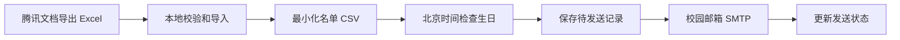

# HUST Birthday Mailer

[](https://github.com/fqs-to/hust-birthday-mailer/actions/workflows/ci.yml)

给学生组织的一份生日祝福，按时送到每个人的邮箱。

**作者：[zxw / fqs-to](https://github.com/fqs-to)** · Python 3.11+ · MIT

为华中科技大学计算机学院资委会准备的小工具：导入通讯录，每天按北京时间检查生日，通过自己的校园邮箱，给当天过生日的成员分别发送祝福。

## 功能

- 公历、农历生日；可配置 2 月 29 日和农历闰月的处理规则。
- 导入腾讯文档导出的 Excel，或 UTF-8 CSV / TSV，识别常见中英文表头。
- 兼容部分腾讯文档导出文件的空填充样式记录，保留日期格式，原文件保持原样。
- 支持 `2007.3.12`、`2008.0811`、`20070318` 等生日写法，导入后只保留月日。
- 纯文本和 HTML 双格式邮件，每封邮件只有一个收件人。
- 默认演练；提供本地预览和只发给自己的测试入口。
- 发送前保存记录，重复运行跳过已有记录，异常结果由管理员人工核实。
- 支持 GitHub Actions 定时运行，也可部署在常在线的 Linux 主机。



仓库里的名单全部是虚构示例。真实通讯录、邮箱凭据和预览文件应保存在已忽略的本地目录，或 GitHub Actions Secrets 中。

## 先在本地试用

Windows PowerShell：

```powershell
python -m venv .venv
.\.venv\Scripts\python.exe -m pip install -e ".[all]"
.\.venv\Scripts\python.exe -m birthday_mailer run --members examples/members.csv --date 2026-11-05
.\.venv\Scripts\python.exe -m birthday_mailer preview
Start-Process .\previews\birthday.html
```

Linux / macOS 使用 `.venv/bin/python`。仅使用公历 CSV 时，程序核心不依赖第三方库；`[xlsx]` 提供 Excel 导入，`[lunar]` 提供农历，`[all]` 安装两者。

`run` 默认只检查名单并显示数量，不连接 SMTP。`--date` 仅用于演练，不能和正式发送的 `--send` 一起使用。

## 准备名单

在腾讯文档中将通讯录导出为 `.xlsx`，放到本项目的 `data/` 目录。第一行应当是表头。程序不会修改腾讯文档，也不会实时同步在线表格；成员变更后需要重新导出、导入，并更新部署端的名单。

推荐在原通讯录增加一列**学校邮箱**，填写本人确认过的完整地址：

```powershell
.\.venv\Scripts\python.exe -m birthday_mailer import data/通讯录.xlsx --sheet 资委会
.\.venv\Scripts\python.exe -m birthday_mailer validate
```

如果只有学号，可以显式生成 `学号@hust.edu.cn` 候选地址：

```powershell
.\.venv\Scripts\python.exe -m birthday_mailer import data/通讯录.xlsx --email-from-student-id
```

**候选地址默认 `enabled=false`。** 确认地址可用后再将对应行改为 `true`。程序保留学号的大小写，不根据 QQ 号推测学校邮箱；已离职成员应停用。

重复导入默认不会覆盖已有文件；确认后可添加 `--overwrite`。完整名单通过校验后才会写入；不认识的日期、重复邮箱、未知状态会报出所在行，不在日志打印个人信息。

输出 `data/members.csv` 的格式：

```csv
name,email,birthday,calendar,is_leap_month,enabled
示例同学,demo@example.edu,11-05,solar,false,true
农历示例,lunar@example.edu,01-01,lunar,false,true
```

| 字段 | 含义 |
| --- | --- |
| `name` | 祝福中的称呼 |
| `email` | 一个完整收件地址 |
| `birthday` | 月日，如 `11-05`；农历填写农历月日 |
| `calendar` | `solar` / `lunar`，也接受“公历” / “农历”；空值默认公历 |
| `is_leap_month` | 是否出生于农历闰月；公历填 `false` |
| `enabled` | 是否发送，`true` / `false`；已有邮箱的导入行，空值默认启用 |

原表中的手机号、QQ、班级、出生年份等字段不会写入输出名单。没有明确历法的旧名单应先与成员确认，不能从日期格式推断公历或农历。

## 配置校园邮箱

复制 `.env.example` 为 `.env`，填写自己的邮箱信息。

`SMTP_FROM_NAME` 是每封邮件中的发件人显示名，`SMTP_USERNAME` 是登录邮箱的账号。修改显示名不会修改邮箱账户资料。云端对应同名 Actions Variable；祝福正文与落款可在 `birthday_mailer/mail.py` 中调整。

```powershell
Copy-Item .env.example .env
python -c "import secrets; print(secrets.token_hex(32))"
```

将生成的随机字符串填入 `STATE_SECRET`，它用于给收件人和生日周期生成 HMAC 标识。**部署后保留同一个值**；更换后旧记录无法识别，程序会停止，避免意外重发。

华科网信办公布的设置是 `mail.hust.edu.cn`、SSL 发信端口 `465`。用户名填写完整校园邮箱；如邮箱要求客户端专用密码，请使用专用密码。需先确认账号已激活、客户端服务可用。参考：[华中科技大学电子邮箱常见问题](https://imo.hust.edu.cn/info/1445/6060.htm)。

先只给自己发一封：

```powershell
.\.venv\Scripts\python.exe -m birthday_mailer test-email --send
```

测试邮件只发往 `SMTP_FROM`（默认等于 `SMTP_USERNAME`），不读取成员名单。确认收件箱中的署名、内容和显示效果，再正式运行：

```powershell
.\.venv\Scripts\python.exe -m birthday_mailer run --send
```

SMTP 返回成功表示服务器已接受邮件；是否最终入箱还需查看收件箱或退信。程序只支持校验证书的 SSL / STARTTLS，不支持明文 SMTP。

## GitHub Actions：不用让电脑一直开机

### 1. 添加 Secrets

仓库 **Settings → Secrets and variables → Actions → Secrets**：

| Secret | 内容 |
| --- | --- |
| `SMTP_USERNAME` | 完整的校园邮箱 |
| `SMTP_PASSWORD` | 邮箱客户端凭据 |
| `MEMBERS_CSV` | 已确认的 `data/members.csv` **完整文本，包含表头** |
| `STATE_SECRET` | 固定的随机密钥，至少 32 字符 |
| `SMTP_FROM` | 可选，通常不需要设置，默认使用 `SMTP_USERNAME` |

真实名单放进 Secret，不上传成仓库文件。更新 Secret 即可替换名单。Secrets 对运行中的工作流可读，所以只让可信人员维护该仓库和工作流。

### 2. 手动测试

进入 **Actions → Birthday greetings → Run workflow**：

1. 选择 `dry-run`，确认校验通过。没有配置真实名单时会明确提示只用虚构示例。
2. 选择 `test`，先验证状态分支的读写，再只给自己发送测试邮件。此步骤也需要配置 `STATE_SECRET`。
3. 核实收件地址、生日历法和启用状态。

### 3. 开启定时发送

在同一设置页的 **Variables** 添加 `BIRTHDAY_ENABLED=true`。此后每天北京时间约 **09:17、12:17、17:17** 检查一次。后两次用于同日补跑，已有记录的生日祝福会跳过；不是每次重复发。

可选变量：`SMTP_HOST`、`SMTP_PORT`、`SMTP_SECURITY`、`SMTP_FROM_NAME`、`ORGANIZATION`、`STATE_COMMIT_NAME`、`STATE_COMMIT_EMAIL`。

本仓库状态提交默认署名为 `zxw`，使用 `fqs-to` 的 GitHub noreply 邮箱。Fork 使用者请把后两个变量改为自己的提交身份。没有共同作者或机器人作者署名。

关闭自动发送：把 `BIRTHDAY_ENABLED` 改为 `false`。

### 发送记录如何保存

Actions 将 `deliveries.json` 保存在单独的 `birthday-state` 分支中；内容只有 HMAC 标识、状态和处理时间，没有姓名、收件地址或生日字段。**公开仓库的这个分支也是公开的**，外部可以看到处理发生的时间及数量，但不能从记录直接读取成员身份。对处理时间也有保密要求时，请使用私有仓库或本地部署。

每封邮件按以下顺序处理：

1. 将 `pending` 记录推送到远程分支。
2. 远程保存成功后，才提交给 SMTP。
3. SMTP 接受后保存 `sent`；提交过程报错则保存 `uncertain`。

进程在途中中断时可能留下 `pending`。这些记录一律跳过，等待人工核实。SMTP 和 Git 不能形成同一个事务，因此这里采用保守的重发策略，不宣称“恰好投递一次”。网络中断可能导致漏发，需要管理员处理。不要删除状态分支；切换部署位置时也需迁移原状态和 `STATE_SECRET`。

GitHub 定时任务可能延迟或被丢弃；公开仓库连续 60 天无活动时，定时工作流会自动停用。应定期查看 Actions，并开启自己账号的失败通知。长期稳定运行可用常在线的主机。规则来源：[GitHub 官方 schedule 说明](https://docs.github.com/en/actions/reference/workflows-and-actions/events-that-trigger-workflows#schedule)。

## 日期与异常处理

- 使用当前北京时间（UTC+8），不依赖电脑或 runner 的本地时区；不会补发以前日期的生日。
- 公历 2 月 29 日在平年默认按 2 月 28 日；可用 `--feb29 mar01` 或 `--feb29 strict` 改为 3 月 1 日或仅闰年。
- 农历按当天对应的农历年月日计算，按农历年份去重。默认将闰月出生者按同名普通月过生日；`--lunar-leap strict` 则仅在实际闰月发送。若要在 Actions 修改规则，将参数加入 `scripts/action_run.py` 的正式运行调用。
- 新增成员时先演练；停用或退出时将 `enabled` 改为 `false`。

收到 `pending` / `uncertain` 提示时，先检查发件服务的记录、退信或与收件人核实。确认已发，使用 `mark-sent`；确认未发，才允许重试：

```powershell
python -m birthday_mailer resolve --email demo@example.edu --occurrence solar-2026 --action mark-sent
python -m birthday_mailer resolve --email demo@example.edu --occurrence solar-2026 --action allow-retry
```

本地默认记录位置为 `data/deliveries.json`。处理 Actions 记录时，在一个**新的、已能推送该仓库的本地克隆**中配置相同的 `STATE_SECRET`、`STATE_COMMIT_EMAIL`，并添加 `--git-state`。命令会从远程读取记录并同步修改，不要编辑或删除整个记录文件。不要同时在本地和 Actions 中启用两套独立的正式发送任务。

## 常在线主机部署

`deploy/` 提供 systemd service / timer 示例。先将代码、虚拟环境和 `data/members.csv` 部署到 `/opt/hust-birthday-mailer`，创建专用的 `birthday` 系统用户，将邮箱配置放到该用户可读的 `/etc/hust-birthday-mailer.env`，并让其可写项目的 `data/` 目录。检查路径和权限后安装 unit 文件并开启 timer。

示例 timer 使用北京时间每天三次检查。`Persistent=true` 会在主机恢复后触发一次检查，但工具始终只处理当日生日。Linux 部署使用本地记录，不需要 GitHub 的写入权限。

## 开发

```powershell
python -m pip install -e ".[all]"
python -m unittest discover -s tests -v
```

测试覆盖日期格式、农历与闰日规则、Excel 导入、个人信息最小化、单收件人邮件、TLS 配置、重复运行、异常中断、状态同步失败和新 runner 恢复状态。测试使用虚构数据和模拟 SMTP，不向真实成员发送邮件。

主要文件：

```text
birthday_mailer/
  contacts.py     名单校验、导入和生日匹配
  mail.py         祝福内容与 TLS SMTP
  ledger.py       HMAC 发送记录和本地并发锁
  git_state.py    Actions 持久状态分支
  service.py      先记账、再投递的流程
  cli.py          命令行入口
.github/workflows/ 定时任务与 Windows / Linux CI
examples/          虚构名单
tests/             自动化测试
```
